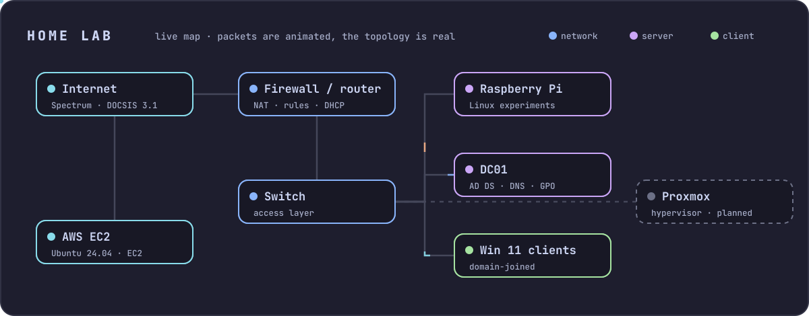
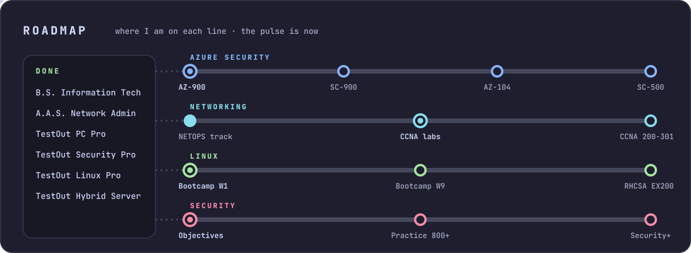
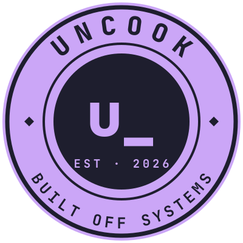

<picture>
  <source media="(prefers-color-scheme: dark)" srcset="assets/banner-mocha.svg">
  <source media="(prefers-color-scheme: light)" srcset="assets/banner-latte.svg">
  
</picture>

  
  
  
  
  

## About me

I work the IT Service Desk at Lehman College (CUNY) and build my own tools on the side. I hold a **B.S. in Information Technology** and an **A.A.S. in Computer Network Administration**, and I run a home lab with Windows Server, Active Directory and VMs.

My life is built off systems: I'd rather build the tracker, the script or the checklist once than wing it every time. Everything here is that habit in public.

<picture>
  <source media="(prefers-color-scheme: dark)" srcset="assets/terminal-mocha.svg">
  <source media="(prefers-color-scheme: light)" srcset="assets/terminal-latte.svg">
  
</picture>

## My security and networking journey

A live log of every milestone, a map of my home lab, and a terminal you can type into. Latest entries:

<!-- JOURNEY:START -->
| When | | Milestone | Track |
| --- | --- | --- | --- |
| Oct 2026 | ▶ | **gemscan: tracing nmap host discovery** | Security |
| Oct 2026 | ▶ | **Uncook Bootcamp: 9-week Linux, Git and LazyVim** | Systems |
| Sep 2026 | ▶ | **Linux on AWS: EC2 learning box** | Systems |
| Sep 2026 | ▶ | **OverTheWire Bandit** | Security |
| Sep 2026 | ▶ | **CCNA 200-301 restart** | Networking |
| Sep 2026 | ▶ | **Azure security path: AZ-900 → SC-900 → AZ-104 → SC-500** | Cloud |

**Next up:** CCNA exam · AZ-900 → SC-500 · RHCSA (EX200)
<!-- JOURNEY:END -->

### The home lab I practice on

<a href="https://cop1ouss.github.io/Cop1ouss/#lab">
<picture>
  <source media="(prefers-color-scheme: dark)" srcset="assets/lab-mocha.svg">
  <source media="(prefers-color-scheme: light)" srcset="assets/lab-latte.svg">
  
</picture>
</a>

## Try my projects

Most of these run in your browser. Click **Open** to use them, no install needed.

<table>
  <tr>
    <td width="50%" valign="top">
      <h3>♟ Blunder Check</h3>
      Free chess game review powered by Stockfish. Explains your mistakes in plain words and turns them into puzzles from your own games. Installs on your phone as an app.  
      <a href="https://cop1ouss.github.io/blunder-check/"><b>Open the app →</b></a> · <a href="https://github.com/Cop1ouss/blunder-check">Code</a> 
      Python · JavaScript · PWA · Stockfish
    </td>
    <td width="50%" valign="top">
      <h3>⌁ NETOPS IT Track</h3>
      A self-paced networking and sysadmin curriculum tracker: home networks to enterprise switching, routing and Active Directory. Aligned to CCNA 200-301, AZ-800 and Cisco JCA.  
      <a href="https://cop1ouss.github.io/cisco-track/"><b>Open the tracker →</b></a> · <a href="https://github.com/Cop1ouss/cisco-track">Code</a> 
      HTML · JavaScript · single-file app
    </td>
  </tr>
  <tr>
    <td width="50%" valign="top">
      <h3>⇄ CCNA Tracker</h3>
      The hands-on side of my CCNA prep: Packet Tracer and GNS3 labs, subnetting drills, flashcards, mock exams and boss battles.  
      <a href="https://cop1ouss.github.io/ccna-tracker/"><b>Browse the guide →</b></a> · <a href="https://github.com/Cop1ouss/ccna-tracker">Code</a> 
      Labs · drills · study system
    </td>
    <td width="50%" valign="top">
      <h3>⛨ Security+ Tracker</h3>
      A self-paced command center for CompTIA Security+ (SY0-701): all 28 objectives, a weighted readiness score and a practice-exam log. No build step, no backend.  
      <a href="https://cop1ouss.github.io/secplus-tracker/"><b>Open the tracker →</b></a> · <a href="https://github.com/Cop1ouss/secplus-tracker">Code</a> 
      HTML · JavaScript · PWA
    </td>
  </tr>
</table>

<b>More projects</b>

 

| Project | What it is | Built with |
| --- | --- | --- |
| [bronx-to-180](https://github.com/Cop1ouss/bronx-to-180) | Mobile-first personal fitness tracker with charts and habits, all stored locally | React · Vite · Recharts |

## Toolbox

**Every day** 

**Building with** 

**Studying now** 

## Roadmap

<picture>
  <source media="(prefers-color-scheme: dark)" srcset="assets/metro-mocha.svg">
  <source media="(prefers-color-scheme: light)" srcset="assets/metro-latte.svg">
  
</picture>

<b>Roadmap as a table</b>

 

| Track | Path | Status |
| --- | --- | --- |
| Azure security | AZ-900 → SC-900 → AZ-104 → SC-500 |  |
| Networking | CCNA 200-301 |  |
| Linux | 9-week hands-on bootcamp → RHCSA |  |
| Done | TestOut PC Pro, Security Pro, Linux Pro, Hybrid Server Pro: Core |  |

<b>How I build: the Build Protocol</b>

 

Every project goes through the same five phases, each with its own color:

1. **Define** (Amethyst): a PRD with the problem, the goal and a measurable finish line
2. **Plan** (Sapphire): the tech plan and the task list
3. **Build** (Onyx): ship a working v1 before polishing anything
4. **Ship** (Ruby): put it in real daily use
5. **Maintain** (Emerald): a monthly check-in so it doesn't rot

Every repo gets a README and a PRD. Unfinished projects get an honest call: keep going, cut scope, or shelve.

## Activity

  
  

<picture>
  <source media="(prefers-color-scheme: dark)" srcset="https://raw.githubusercontent.com/Cop1ouss/Cop1ouss/output/snake-dark.svg">
  <source media="(prefers-color-scheme: light)" srcset="https://raw.githubusercontent.com/Cop1ouss/Cop1ouss/output/snake-light.svg">
  
</picture>

---

   
  © 2026 Dajoni Gomez · Uncook™ · built off systems

